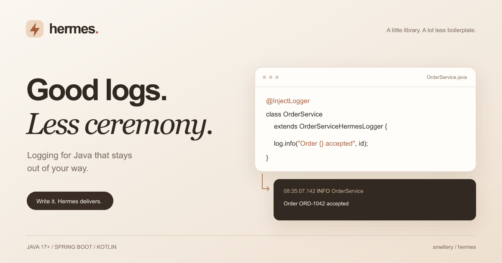

#  Hermes

Logging for Java that stays out of your way. Write the message; Hermes handles delivery.

[](https://github.com/smeltery/hermes/actions/workflows/ci.yml)
[](https://github.com/smeltery/hermes/releases)
[](LICENSE)


[](docs/development/tooling.md)



- **Small API:** five log levels, parameterized messages, suppliers, markers, and MDC.
- **Less setup:** `@InjectLogger` generates a superclass with a ready-to-use logger.
- **Flexible delivery:** console, rotating files, Logstash, JSON, and optional async appenders.
- **Your stack:** Spring Boot configuration, Kotlin helpers, and GraalVM metadata.

```java
import io.github.smeltery.hermes.Logger;
import io.github.smeltery.hermes.LoggerFactory;

Logger log = LoggerFactory.getLogger("orders");
log.info("Order {} accepted", "ORD-1042");
```

## Start here

See [docs/](docs/README.md) for [installation](docs/src/getting-started/installation.md),
[quick start](docs/src/getting-started/quick-start.md),
[integrations](docs/src/integrations/spring-boot.md), and
[architecture diagrams](docs/src/architecture/overview.md).
The website renders these same Markdown sources at `/docs`.

## Develop

```sh
flox activate
bun install --frozen-lockfile
pre-commit install --install-hooks
bun run check
```

Java builds use Maven; Bun manages the website and validation tooling.
See [development](docs/development/tooling.md) for local commands,
[CI and releases](docs/development/releases.md) for automation, and
[contributing](CONTRIBUTING.md) for the LOC budget and checks.

## License

[PolyForm Shield License 1.0.0](LICENSE). Copyright © 2026 smeltery.
