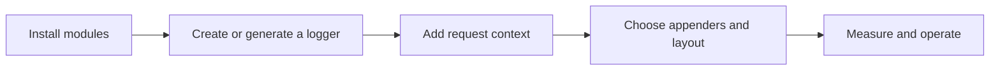

# Hermes documentation

The user guide lives in `src/` and is shared by the website and MkDocs.
Start with installation, then choose the integration for your application.

| Task | Guide |
| --- | --- |
| Install the library | [Maven and Gradle](src/getting-started/installation.md) |
| Write your first log | [Quick start](src/getting-started/quick-start.md) |
| Generate a logger | [Logger injection](src/user-guide/logger-injection.md) |
| Attach request context | [MDC](src/user-guide/mdc.md) |
| Choose an output | [Appenders](src/advanced/appenders.md) and [layouts](src/advanced/layouts.md) |
| Move output off the caller | [Async logging](src/advanced/async-logging.md) |
| Integrate a framework | [Spring Boot](src/integrations/spring-boot.md), [Kotlin](src/integrations/kotlin.md), [GraalVM](src/integrations/graalvm.md) |
| Understand the design | [Architecture](src/architecture/overview.md) and [modules](src/architecture/modules.md) |
| Browse signatures | [Core API](src/api/core.md), [appenders](src/api/appenders.md), [layouts](src/api/layouts.md) |
| Build and contribute | [Tooling](development/tooling.md), [releases](development/releases.md) |

Diagrams use Mermaid. CI parses every Mermaid fence, lints Markdown, checks local
links and anchors, and builds both documentation frontends. Edit `src/` once;
do not keep a second copy of the content in the website.
