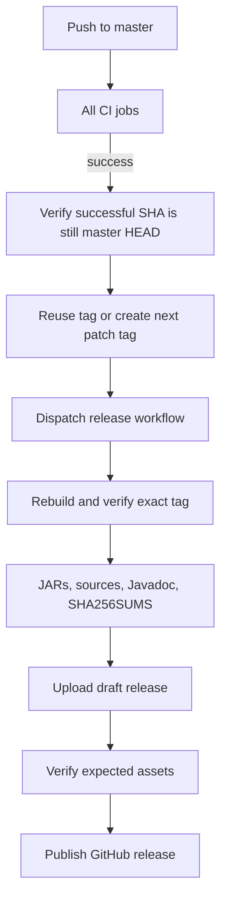

# CI and releases

## Pull requests

CI runs read-only checks on every pull request and push to `master`: the locked
Flox environment, all local validation, the complete Maven reactor, generated
annotation-processor sources, and the production website. Java 21 runs separately.
MkDocs builds with strict warnings. Dependency updates arrive through Dependabot.

## Automatic releases



The auto-release workflow listens only to successful **push** runs from this
repository's default branch. It tags the tested SHA, never a newer untested commit.
Strict `vMAJOR.MINOR.PATCH` tags determine the next patch; an empty history starts
at the POM version. Re-running is idempotent. A failed dispatch can be retried.

The release workflow accepts a `tag` through workflow dispatch or a pushed tag.
It checks ancestry, sets the Maven reactor version to the tag in the build workspace,
and builds JARs, source JARs, and Javadoc. These version edits are not committed.
Examples are tested but not included in the library release bundle. Assets are
uploaded to a draft and checked before publication; failures leave a recoverable draft.

## Maven Central

GitHub releases and Maven Central publication are separate. Central publication is
an explicit manual dispatch after reviewing a release. It needs `CENTRAL_USERNAME`,
`CENTRAL_TOKEN`, `GPG_PRIVATE_KEY` (armored text), and `GPG_PASSPHRASE` repository
secrets. The workflow uses the `maven-central` environment and the exact release tag.
Configure environment reviewers in GitHub if publication needs approval.

```sh
gh workflow run release.yml -f tag=v1.0.1
gh run list --workflow release.yml
gh run watch RUN_ID --exit-status
```

Do not publish SNAPSHOT versions or move existing tags. Maven coordinates are
`io.github.smeltery`; Java packages start with `io.github.smeltery.hermes`.
