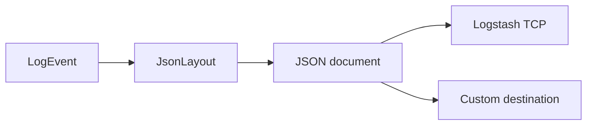

# JSON Logging

`JsonLayout` serializes a Hermes `LogEvent` for ingestion by structured-log tools.

## Layout

```java
import io.github.smeltery.hermes.core.layout.JsonLayout;

JsonLayout compact = new JsonLayout();
JsonLayout readable = new JsonLayout(true);
String json = compact.format(event);
```

The event contains timestamp, level, logger, thread, thread ID, and message.
MDC, marker, and throwable details are included when present. Thread ID is emitted
as a JSON string. Pretty printing is useful for inspection; use compact output for
line-oriented ingestion.

## Example event

```json
{
  "timestamp": "2026-10-16T12:35:07.142Z",
  "level": "INFO",
  "logger": "orders",
  "thread": "main",
  "threadId": "1",
  "message": "Order ORD-1042 accepted",
  "mdc": {"orderId": "ORD-1042"}
}
```

## Choosing a destination

The built-in `LogstashAppender` uses `JsonLayout`. The console, file, and rolling
file constructors currently accept `PatternLayout`, **not** `JsonLayout`.
For a custom JSON file destination, implement `Appender`, serialize each event,
and manage the file lifecycle explicitly. Do not pass a `JsonLayout` to a
`FileAppender` constructor.



## Operational considerations

Redact credentials and personal data before logging. Set predictable MDC keys,
keep messages bounded, and test output against your ingestion parser. JSON formatting
alone does not provide durable delivery, retention, or access control.

See [Logstash](logstash.md), [MDC](../user-guide/mdc.md), and
[layout signatures](../api/layouts.md).
