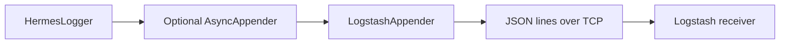

# Logstash Integration

`LogstashAppender` sends compact JSON events to a TCP destination.

## Configure the appender

```java
import io.github.smeltery.hermes.core.appender.LogstashAppender;

LogstashAppender appender = new LogstashAppender("logstash", "localhost", 5000);
appender.start();
// Attach the appender to a HermesLogger or custom LoggerProvider.
// Stop after the application's final log event.
appender.stop();
```

Constructing an appender does not attach it to the default provider. See
[appenders](appenders.md) for the explicit wiring API.

## Receiver example

```ruby
input {
  tcp {
    port => 5000
    codec => json_lines
  }
}
output {
  stdout { codec => rubydebug }
}
```

Run the receiver on a trusted local network and verify the newline-delimited JSON
with your deployed Logstash version. The appender has no built-in TLS/authentication
configuration; use a suitable secured transport boundary if logs leave the host.

## Delivery path



## Failure handling

Connection and write failures are reported by the appender. It is not a durable
queue and should not be treated as an audit ledger. Test disconnects, receiver
restarts, saturation, and shutdown under your workload. If delivery cannot block
the caller, evaluate [async logging](async-logging.md), including its buffer limits.

See [JSON events](json-logging.md) and [appender signatures](../api/appenders.md).
