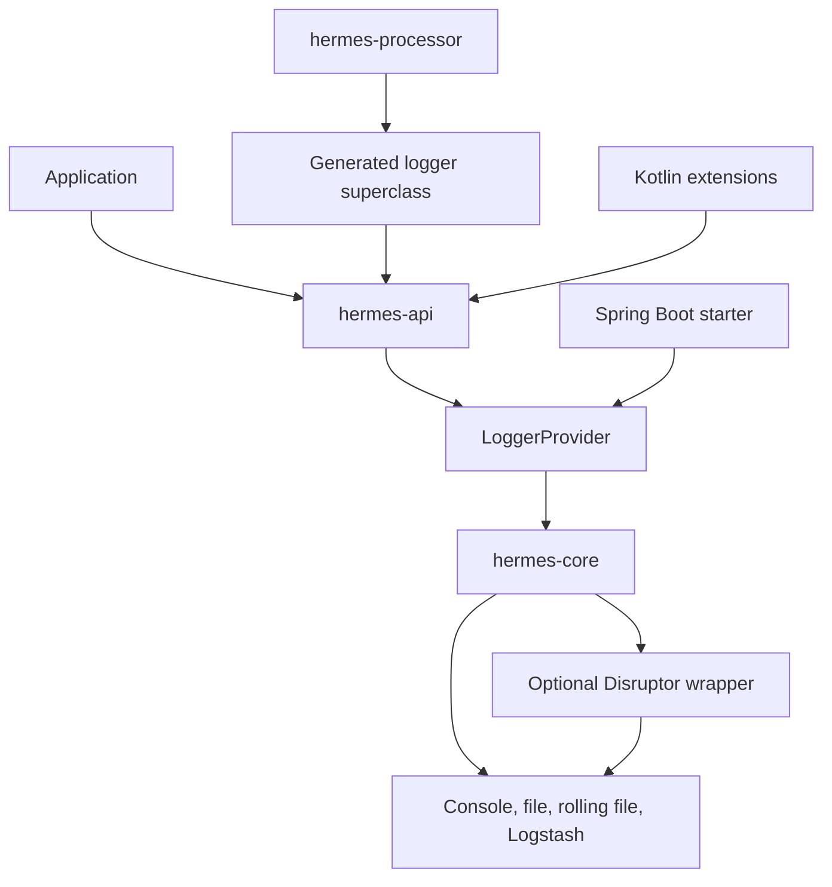
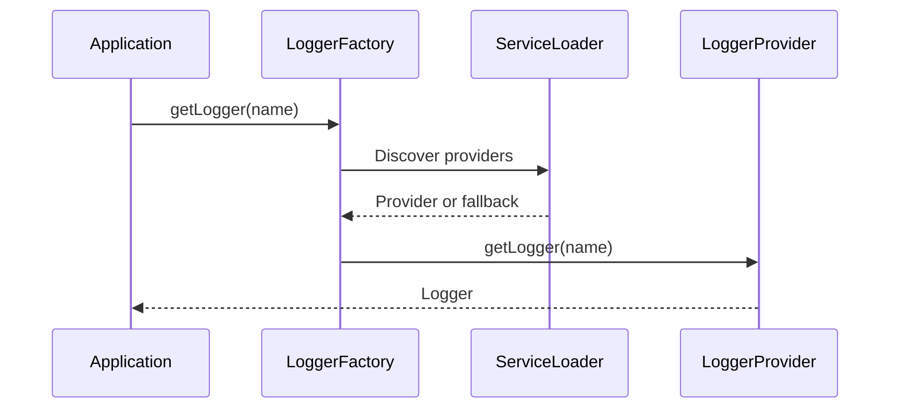

# Architecture Overview

Hermes separates its public logging API from delivery, compile-time generation,
and framework integrations. The API discovers a provider through Java ServiceLoader.

## High-Level Architecture

## Provider discovery

Include `hermes-core` at runtime; with no provider, the API falls back to no-op
logging. `LoggerFactory.setProvider` supports explicit provider replacement.
Existing logger references retain the provider instance from which they were created.

## Event delivery

The logger checks its level, snapshots context, and creates an
event. Appenders apply a layout and write to their destination. The async wrapper
publishes events through a bounded Disruptor ring buffer and delegates on a consumer
thread. A saturated buffer can make the calling thread wait.

MDC is thread-local. Async delivery captures event context but does not propagate
application context into arbitrary executors or coroutines.

## Compile-time generation

`@InjectLogger` causes the annotation processor to generate a named superclass.
Applications explicitly extend that class. This is source generation, not runtime
reflection or bytecode mutation. See [logger injection](../user-guide/logger-injection.md).

## Boundaries

- The core is not an SLF4J bridge.
- Built-in destinations differ in accepted layouts; check their constructors.
- Output can allocate memory and perform I/O. No zero-allocation guarantee is made.
- The Spring starter applies levels; other bound properties are not all wired to delivery.

See [module structure](modules.md), [performance](performance.md), and
[Spring Boot](../integrations/spring-boot.md).
