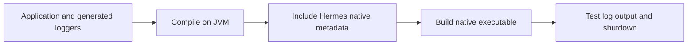

# GraalVM Native Image

`hermes-core` ships native-image metadata under `META-INF/native-image/`.
Annotation-generated logger classes are ordinary bytecode; they do not require
runtime field injection.

## Prerequisites

Use a GraalVM distribution compatible with your application's Java target and
install its native build prerequisites. The Flox development environment supplies
a JVM, not a native-image compiler.

Check your toolchain before building:

```sh
java -version
native-image --version
```

## Build your application

Configure your application's native build plugin and include Hermes API/core on
its classpath. For an executable JAR that already contains runtime dependencies:

```sh
native-image --no-fallback -jar application.jar
```

An ordinary thin JAR is insufficient unless you also provide its dependency
classpath. Spring Boot native applications should use Spring's native build flow.

## Verify the result



Test provider discovery, each configured appender, MDC, exception output, and
shutdown in the native executable. A passing JVM build is not proof of native
compatibility for your particular dependency graph.

## Troubleshooting

- Missing output: check provider service metadata and the root log level.
- Missing resources: ensure the runtime artifact and configuration resources are packaged.
- Async failures: verify the Disruptor dependency is included and test queue shutdown.
- Custom appenders using reflection may need their own reachability metadata.

No native startup-time or memory guarantees are made. Measure the final application;
see [performance](../architecture/performance.md).
