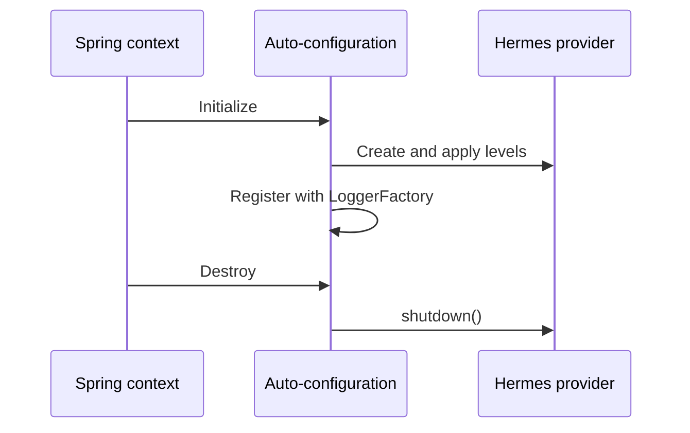

# Spring Boot Integration

The starter registers a Hermes provider, applies root/package log levels, and
shuts it down with the Spring application context. It targets Spring Boot 3 and Java 17+.

## Installation

```xml
<dependency>
  <groupId>io.github.smeltery</groupId>
  <artifactId>hermes-spring-boot-starter</artifactId>
  <version>1.0.0</version>
</dependency>
```

For `@InjectLogger`, also configure the processor from the
[installation guide](../getting-started/installation.md).

## Configuration

```yaml
hermes:
  level:
    root: INFO
    packages:
      com.example.orders: DEBUG
```

The current auto-configuration applies `hermes.level` values. Although
`HermesProperties` also binds `pattern` and `async` settings, the auto-configuration
does not currently wire them to appenders. Configure custom delivery explicitly;
do not assume YAML alone enables async output or changes the pattern.

## Usage

```java
import io.github.smeltery.hermes.Logger;
import io.github.smeltery.hermes.LoggerFactory;
import org.springframework.stereotype.Service;

@Service
public class OrderService {
    private final Logger log = LoggerFactory.getLogger(OrderService.class);

    public void accept(String orderId) {
        log.info("Order {} accepted", orderId);
    }
}
```

Hermes is a separate logging API. The starter does not bridge every SLF4J call or
replace all Spring framework logging. Applications using multiple logging APIs
must configure those systems separately.

## Lifecycle



The starter exposes a `HermesLoggingHealthIndicator`. Actuator exposure is governed
by your application's own management configuration.

## MDC with Web Requests

Set context at a request boundary and always clear it in a `finally` block.
MDC is thread-local, so executor tasks require explicit context propagation.
See [MDC](../user-guide/mdc.md) and [examples](../examples.md).

## Troubleshooting

- Check the package prefix in YAML if debug messages are missing.
- Ensure `hermes-core` is on the runtime classpath.
- Create application loggers after the provider is initialized when relying on
  the configured provider; replacing a provider does not rewrite existing logger references.
- See [async logging](../advanced/async-logging.md) for manual queue configuration.
